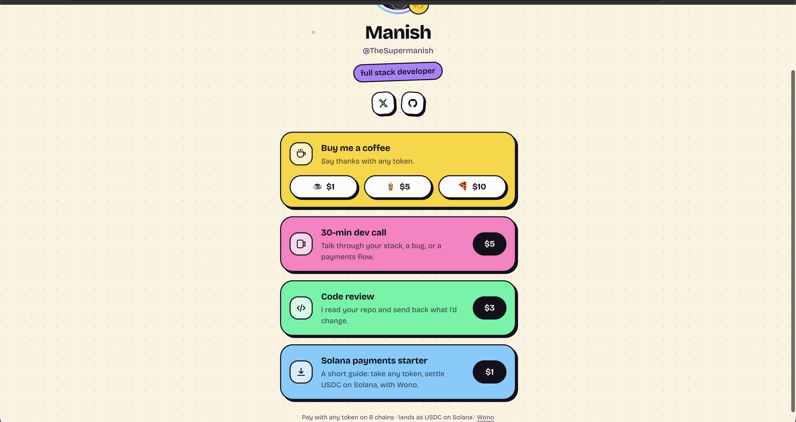
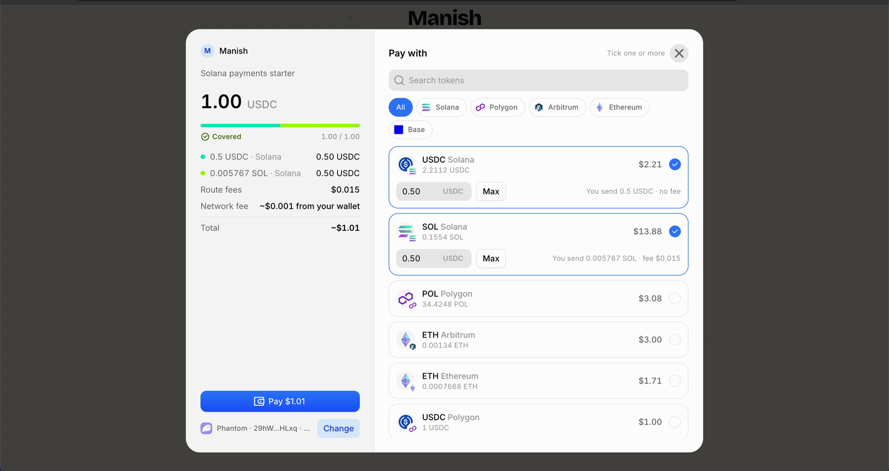
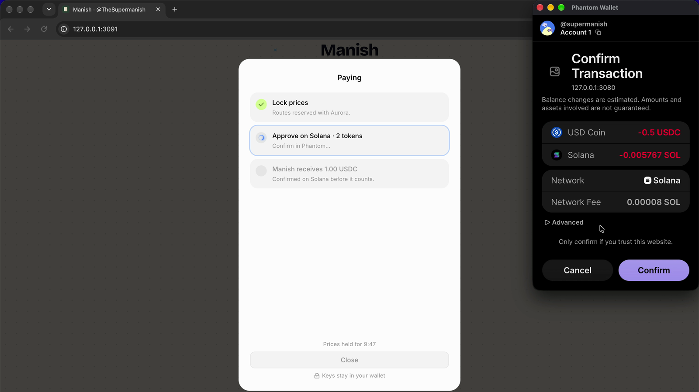
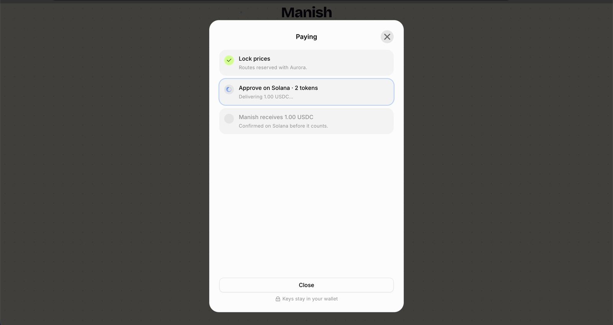
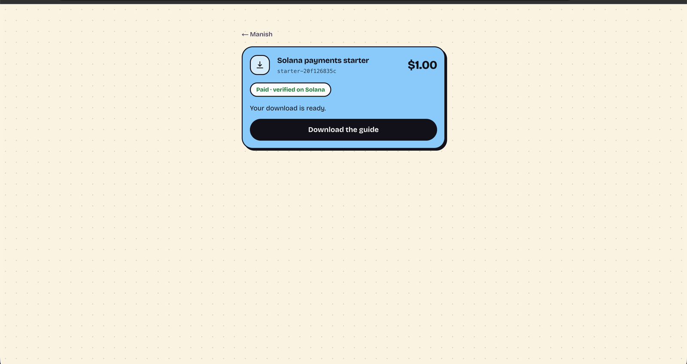
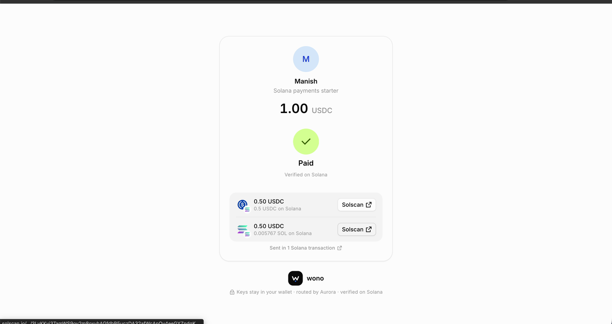
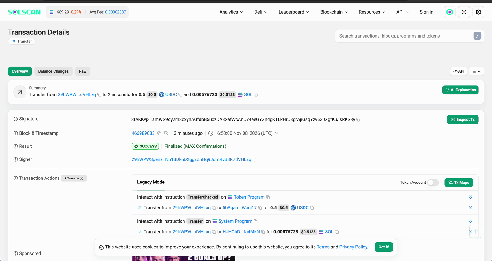
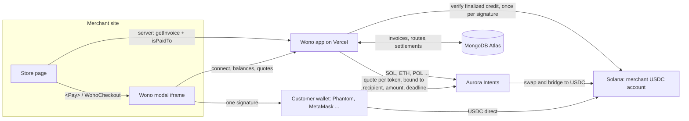

# Wono: pay with anything, get USDC on Solana

**We Only Need One.** One button, one signature, any token on any chain, and the merchant
gets native USDC on Solana. **Live on Solana mainnet.**

- **Live demo:** [wonopay-store.vercel.app](https://wonopay-store.vercel.app), an example store built with the Wono SDK
- **Wono app:** [wonopay.vercel.app](https://wonopay.vercel.app)
- **Demo video:** [youtu.be/1nxeOwq1Cv8](https://youtu.be/1nxeOwq1Cv8)

## The problem

A merchant wants USDC on Solana. The customer's money is spread across chains: a little ETH
on Base, some SOL, a few dollars of USDC on Polygon. No single token covers the bill. To pay,
they swap on one app, bridge on another, find gas on every chain, then paste an address and
hope it is right. Three apps, three fees, and most customers give up.

## The solution

Wono is a checkout the merchant drops into their page. The customer connects the wallet
they already have, sees every balance on every supported chain, ticks the tokens they want
to spend, and Wono splits the price across them. Solana tokens go out in **one
transaction**; EVM tokens take one approval per wallet. **Aurora Intents** swaps and bridges
everything that is not already USDC on Solana. Wono marks the invoice paid only after it
verifies the finalized USDC credit on Solana, and the money lands in the merchant's own
wallet. Wono never holds funds.

## Live on mainnet

Real payments, made through the live checkout, each $1.00 split as 0.50 USDC + 0.50 of SOL
and sent in a single Solana transaction:

| Invoice | Transaction |
| --- | --- |
| `inv_FOhQOBuZGsRVW8Xc` | [3LvKKvj3…RKS3y](https://solscan.io/tx/3LvKKvj3TamWS9oy2m8oxyhAGfdbB5uczDA32afWcAnQv4eeGYZndgK16kHrC3grAjiGsqYzv63JXgtKuJsRKS3y) |
| `inv_kVzgEg28W31ik3wM` | [4uqVjdtD…56H4t6](https://solscan.io/tx/4uqVjdtDfLeqUw7YeXqrfKwX6rir9msT5EqTGeSHCZSzTV6m8FQyWGPuhUYohjQRodtsCo4dfSnUZBxoMY56H4t6) |
| `inv_m1X9-4wNLmTyyGpw` | [5nUntA4t…kB9xo](https://solscan.io/tx/5nUntA4tekyt1nBHEnz9fJDqGUMv2oAbj2WNHJBAYVL1AmDFihtCYHP6rJm5Y7z1ctQb5EhFBhzP9pNMYF1kB9xo) |

## See it work

| | |
| --- | --- |
|  **1. A store built with the SDK.** Click buy. |  **2. The Wono modal opens on the same page.** Real balances on every chain; tick SOL next to USDC and the dollar splits 0.50 / 0.50. |
|  **3. One signature.** Phantom shows exactly what leaves the wallet: 0.5 USDC and 0.005767 SOL, one Solana transaction. |  **4. Prices locked, routes reserved with Aurora.** USDC lands directly; SOL is swapped to USDC. |
|  **5. Paid, verified on Solana.** The store unlocks the download only after its server re-reads the invoice. |  **6. Receipt.** Both tokens, one transaction, Solscan links. |



## Add it to your site

No account and no API key: payments go straight to your Solana wallet.

```tsx
import { Pay } from "@wono/react";

<Pay to="YOUR_SOLANA_WALLET" amount="10" description="Pro plan" />
```

Before unlocking anything, check on your server:

```ts
import { getInvoice, isPaidTo } from "@wono/sdk";

const invoice = await getInvoice(id, { refresh: true });
if (isPaidTo(invoice, { to: WALLET, amount: "10" })) unlock();
```

Merchants who want a dashboard, API keys, analytics and embed origins sign up on the app.
AI agents and APIs can charge per call over HTTP 402 with `@wono/x402`.

## Architecture



- **Bound quotes.** Each Aurora quote is checked against the requested asset, recipient,
  amount, refund address, deadline and deposit route, and saved before the customer signs.
- **Paid means on-chain.** An invoice is paid only after a finalized Solana credit of the
  invoice mint to the merchant, recorded once per signature (unique index). Iframe events and
  return URLs never mark anything paid.
- **Honest states.** Open, partial, paid, failed, refunded and expired stay distinct; a short
  or failed part keeps the invoice partial, and nothing is ever resent automatically.
- **Storage.** MongoDB Atlas with transactions for every money write; deployed on Vercel.

## Repository

TypeScript monorepo (npm workspaces):

| Path | What |
| --- | --- |
| `packages/sdk` | `@wono/sdk`: merchant API client (`Wono`), Aurora client, quote binding, status binding, invoice state machine, Solana settlement verification. Zero runtime dependencies, no React/Next. |
| `packages/react` | `@wono/react`: `<WonoCheckout>`, the embedded checkout as a React component. |
| `packages/x402` | `@wono/x402`: pay-per-call APIs. `wonoPaywall` puts a route behind HTTP 402; `wonoFetch` pays those 402s from a wallet; `@wono/x402/solana` signs with a Solana keypair. |
| `apps/web` | Next.js 16 app: merchant dashboard, hosted and embeddable checkout, API, MongoDB storage. BoardUI components. |
| `examples/store` | Example merchant store (zero dependencies): creates invoices with the server API, embeds checkout, fulfils only on a verified `paid`. |
| `examples/react-store` | The same store in Next.js with `@wono/sdk` and `@wono/react`, plus an x402 pay-per-call API. |
| `examples/agent` | An agent that pays for that API from its own Solana wallet, routed by Aurora Intents. |
| `docs/settlement-architecture.md` | The settlement decision and the live evidence behind it. |

## Run

```sh
npm ci
cp apps/web/.env.example apps/web/.env.local   # set WONO_AURORA_API_KEY
npm run dev                                    # builds the SDK, starts http://127.0.0.1:3080
```

```sh
npm test         # SDK unit tests + web payment-flow tests (HTTP fixtures, no network)
npm run typecheck
npm run build    # SDK (tsc) + Next production build
npm run probe -- <merchant-solana> <refund-evm> <refund-solana>   # live dry quotes, moves nothing
```

Requires Node ≥ 22.18 (native TypeScript for tests) and a MongoDB replica set for storage (`MONGODB_URI`; MongoDB Atlas works, tests start an in-memory one).

## How a payment works

1. **Invoice.** The merchant sets a Solana settlement wallet (checked: on-curve wallet, not
   a token or program account) and creates an invoice. The amount, Solana USDC asset id,
   mint, and recipient are snapshotted on the invoice.
2. **Wallets.** Checkout discovers real browser wallets: Solana via Wallet Standard
   (Phantom, Solflare, Backpack…), EVM via EIP-6963 (MetaMask, Rabby, Coinbase…).
3. **Balances.** Read server-side from chain RPC: SOL + the associated token account of
   each catalog mint; EVM native + `balanceOf`. A failed read shows as unknown, never 0.
4. **Allocation.** The customer ticks tokens and sets each one's share (slider or exact
   USDC). Shares must add up to exactly what is still payable.
5. **Quotes.** Dry Aurora quotes per share: source amount, USD estimate, route cost, time.
6. **Reserve.** `POST /api/pay/:id/attempts` requests one non-dry quote per share, binds
   each response to the exact request (asset, amount, recipient, refund address, deadline),
   and stores every route before any is shown. Unprompted routes from an earlier attempt
   are cancelled. The attempt key (random, held by the browser) authorizes later actions.
7. **Approve.** The server builds the exact transfer and atomically marks the route
   `awaiting_approval` (a route reaches a wallet once):
   - Solana USDC shares pay the merchant directly (no Aurora route, no route fee).
   - Solana gas is sponsored when `WONO_SOLANA_FEE_PAYER_SECRET` is set and that wallet holds
     ≥ 0.01 SOL: Wono's wallet is the fee payer and pays any token-account rent. The customer
     signs only their transfers; Wono co-signs a message only after checking it matches the
     prepared transfer, and refuses wallet-added priority fees above 1 lamport/CU.
   - Solana: all shares from one wallet in **one transaction**, signed with
     `solana:signTransaction`; Wono checks the signed bytes match, stores the signature
     and bytes, *then* broadcasts. Rebroadcasting identical bytes cannot pay twice.
   - EVM: switch network, then `eth_sendTransaction` (ERC-20 `transfer` or native value).
8. **Track.** `POST /api/pay/:id/refresh` reconciles: Aurora status (bound to the saved
   quote signature, deposit address, and request), source-chain receipts/signatures, then
   for provider `SUCCESS` the destination Solana transaction at `finalized` commitment:
   success, USDC mint, merchant owner, net credit. Each settlement signature is stored
   once (`UNIQUE(chain, signature)`), so it can never be credited twice or to two invoices.
9. **Paid** means verified finalized credit ≥ amount. Merchants confirm server-side with
   `GET /api/v1/invoices/:id?refresh=1` (Bearer API key). Iframe events and return URLs
   are display hints only.

## Settlement policy

Direct: every share settles to the merchant **independently** through its own Aurora
route. A share already in native Solana USDC needs no route: it is transferred straight to
the merchant (no route fee) and verified the same way. There is no rollback of a completed share if another fails. Aurora refunds a failed
share to the wallet that sent it. The invoice is then `partial`; the remaining amount stays
payable, and the merchant decides whether to wait or refund from their own wallet.
Collecting into a customer-controlled Intents balance first was investigated; see
[docs/settlement-architecture.md](docs/settlement-architecture.md) for why it is not shipped.

## States

Contribution: `quoted` → `awaiting_approval` → `submitted` → `processing` → `settled`
(provider says done) → `verified` (on-chain). Also `refunded`, `failed`, `unknown`,
`cancelled` (never sent), `expired` (never sent: window closed, or a signed Solana
transaction provably can no longer land).

Invoice: `open`, `quoted`, `awaiting_approval`, `submitted`, `processing`, `partial`,
`paid`, `refunded`, `failed`, `unknown`.

Uncertain outcomes (`unknown`, `awaiting_approval` without a result) keep their amount
reserved: the customer is never asked to pay it again, and nothing is resent
automatically. They resolve from evidence: Aurora deposit activity, a failed/landed
signature, blockhash expiry (Solana `signTransaction` path), or the route going inactive.

## Embedding

The merchant lists allowed origins in Settings. `/embed/:id?parent=<origin>` is served with
`frame-ancestors <origin>` and renders only if that origin is on the list; every other
route is `frame-ancestors 'none'`. Checkout posts `wono:ready`, `wono:resize`, and
`wono:status` to exactly that origin. The snippet in the dashboard checks both
`event.origin` and `event.source`. Checkout accepts no inbound messages.

### SDK and React

```ts
// Server: the secret key stays here.
import { Wono } from "@wono/sdk";
const wono = new Wono({ apiKey: process.env.WONO_API_KEY!, baseUrl: "https://wonopay.vercel.app" });
const invoice = await wono.invoices.create({ amount: "25.00", reference: "order-42" });
// later, before fulfilling:
const latest = await wono.invoices.retrieve(invoice.id, { refresh: true });
if (latest.state === "paid") ship();
```

```tsx
// Client: embeds /embed/:id for this page's origin (add it under Settings → Embed origins).
import { WonoCheckout } from "@wono/react";
<WonoCheckout invoiceId={invoice.id} baseUrl="https://wonopay.vercel.app" onStatus={() => router.refresh()} />
```

`onStatus` is a hint to re-read the invoice on your server; it never means paid. The
`Wono` client refuses to run in a browser because it holds the secret key.

`examples/react-store` is a Next.js store built this way: a server action creates the
invoice, the order page reads `retrieve(id, { refresh: true })` on the server, and the
embedded checkout's status messages only call `router.refresh()`.

```sh
# Add http://127.0.0.1:3091 to Embed origins first.
WONO_API_KEY=wono_sk_… npm run store:react    # http://127.0.0.1:3091
```

### Agents and x402

An API can charge per call with HTTP 402 and a Wono invoice. The 402 body follows x402 v1
(`x402Version`, `accepts[]`) with the scheme `wono-invoice`: the requirement carries an invoice
id. The client pays that invoice with whatever it holds (Solana USDC goes direct; SOL and other
tokens are routed by Aurora Intents), then retries with `X-PAYMENT`. The server releases the
resource only when `wono.invoices.retrieve(id, { refresh: true })` is `paid`, the invoice is bound
to that resource, and it has not been redeemed before. `exact`-scheme x402 clients do not
understand `wono-invoice`.

`@wono/x402` packages both sides. The wire helpers (`paymentRequired`, `findWonoRequirement`,
`encodePaymentHeader`, ...) and `WonoPay`, the public checkout API for code, stay in `@wono/sdk`.

Server: wrap any Fetch-API handler (Next.js route, Hono `c.req.raw`, Bun, Deno).

```ts
import { wonoPaywall } from "@wono/x402";

const paid = wonoPaywall({ wono: () => new Wono({ apiKey: process.env.WONO_API_KEY! }), price: "0.25", description: "Weather report" });
export const GET = paid(async (request, { invoice }) => Response.json(await report()));
```

The paywall creates an invoice whose reference is bound to the resource URL, answers 402 with it,
and on retry releases the handler only when Wono reports the invoice `paid` and it has not been
redeemed. Redeemed ids live in memory by default; pass `store: { claim(id) }` (atomic, true only
for the first caller) backed by your database in production.

Client: a `fetch` that pays.

```ts
import { wonoFetch } from "@wono/x402";
import { solanaKeypairSigner } from "@wono/x402/solana";

const pay = wonoFetch({ ...solanaKeypairSigner(keypair), maxUsdc: "5" });
const response = await pay("https://api.example.com/report");
```

On a `wono-invoice` 402 it pays through Wono only if that Wono is in `trustedWonoUrls` (default
`https://wonopay.vercel.app`), checks the 402 against the invoice Wono reports and against `maxUsdc`, picks
Solana USDC (direct) or SOL (routed by Aurora Intents, keeping 0.005 SOL for fees), refuses routes
that moved more than 2% from the quote, signs the exact transaction Wono built, waits for
verification, and retries once with `X-PAYMENT`. Other responses pass through untouched. The
signer refuses transactions that touch programs other than System, SPL Token, Token-2022, ATA,
Compute Budget and Memo, or that it is not a signer of. Nothing holds keys but the signer.

- `examples/react-store/app/api/report/route.ts`: a pay-per-call API (live token prices) on `wonoPaywall`.
- `examples/agent/agent.ts`: an agent with its own Solana key that buys that API with `wonoFetch`.

```sh
solana-keygen new -o ~/.config/solana/agent.json      # fund it with a little SOL or Solana USDC
AGENT_KEYPAIR=~/.config/solana/agent.json node examples/agent/agent.ts http://127.0.0.1:3091/api/report --wono http://127.0.0.1:3080 --dry-run
AGENT_KEYPAIR=~/.config/solana/agent.json node examples/agent/agent.ts http://127.0.0.1:3091/api/report --wono http://127.0.0.1:3080 --pay-with SOL
```

`--wono` names the Wono the agent trusts (default `https://wonopay.vercel.app`); `--max-usdc` caps the price
(default 5). Every unpaid call creates an invoice, so rate-limit the endpoint in production.

### Example store

`examples/store/server.ts` is a complete merchant integration in one file:

```sh
# In Wono: Settings → set the settlement wallet, add http://127.0.0.1:3090 to Embed origins,
# then create a server API key.
WONO_API_KEY=wono_sk_… npm run store    # http://127.0.0.1:3090
```

"Buy now" creates an invoice server-side (`POST /api/v1/invoices`), the order page embeds
`/embed/:id?parent=http://127.0.0.1:3090`, and checkout messages only trigger a server
check of `GET /api/v1/invoices/:id?refresh=1`. The order shows paid only when that returns
`state: "paid"`. Options: `WONO_URL`, `STORE_PORT`, `STORE_ORIGIN`, `STORE_PRODUCT`,
`STORE_PRICE` (USDC, default 1.00).

## Verified vs. not verified

Verified against live services (2026-11-05): Aurora token catalog (215 tokens; Solana USDC
asset ↔ mint check), dry and non-dry quotes for Base USDC, SOL, and Solana USDC into
Solana USDC; status binding (`PENDING_DEPOSIT`); Solana batch transaction build from
mainnet RPC; EVM transfer request; live balances on Solana and Base; Phantom detected via
Wallet Standard and EIP-6963 in a real browser.

Not verified: a funded payment. No transaction was signed or broadcast; real approval is
left to the customer's wallet. Specifically unexercised: Aurora detecting an SPL deposit
to the deposit address's token account, settlement on `SUCCESS` with real destination
hashes, refunds, `INCOMPLETE_DEPOSIT` handling, and Aurora creating a merchant USDC
account that does not exist yet.

## Limits

- Storage is MongoDB (a replica set, for transactions); runs on Vercel with Atlas. Sign-in
  and link-creation throttling are in-memory, so per instance on serverless.
- Public RPC defaults are rate-limited; set `WONO_RPC_SOL` etc. for production.
- Desktop browser-extension wallets only (no WalletConnect / mobile deep links yet).
- EVM shares need one approval each (no EIP-5792 batching yet), and EVM gas is paid by the
  customer (no paymaster or gasless relay yet).
- Each Aurora route into Solana costs a flat ~0.237 USDC plus ~0.5% spread, so cost grows
  with the number of tokens used. Auto-pick uses the fewest routes; Solana USDC is direct.
- Reconciliation runs on page polls and API calls; there is no background worker or
  merchant webhook yet.

## References

[Aurora Swap API](https://docs.intents.aurora.dev/intents-swap/what-is-swap-api) ·
[Quote](https://docs.intents.aurora.dev/api-reference/swap-api-reference/request-a-quote) ·
[Status](https://docs.intents.aurora.dev/api-reference/swap-api-reference/get-swap-status) ·
[NEAR Intents account abstraction](https://docs.near-intents.org/integration/verifier-contract/account-abstraction)
